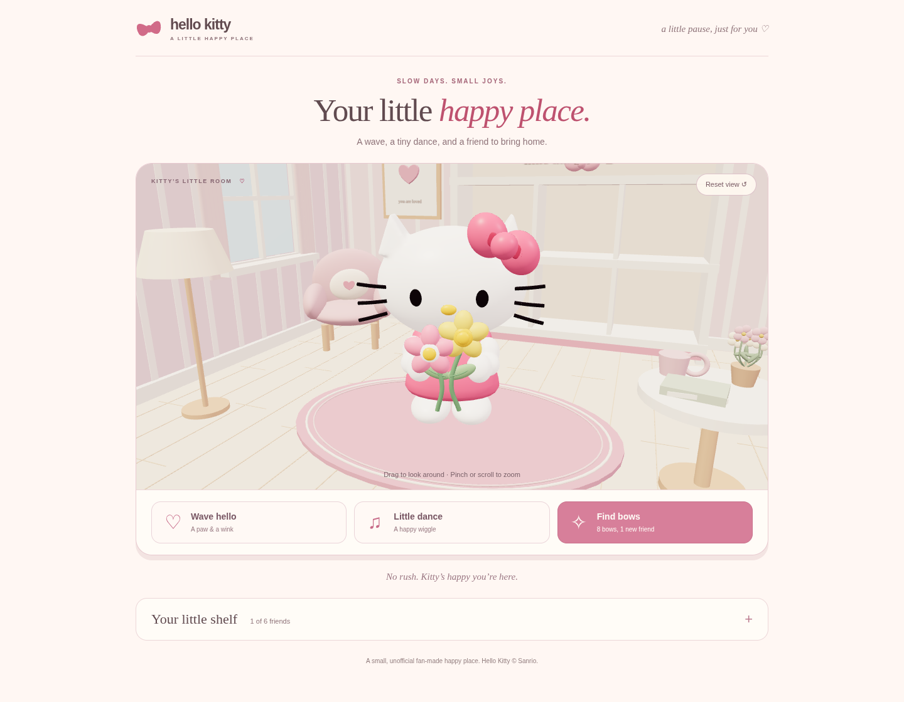

# Hello Kitty · A little happy place

A small browser game built around **our actual Blender Hello Kitty model**.
The home page has just three actions:

- **Wave hello:** a raised, thumb-free paw and the Blender wink.
- **Little dance:** the character’s exported bounce and sway.
- **Find bows:** find eight bows in 45 seconds to bring one new friend home.

The collection and room colors sit inside a single expandable shelf panel.
There is no chat, shop, wallet, daily checklist, personalization flow, or extra
game navigation on the main page. All six friends use the imported Blender
character, with outfit recolors for the collection variants.



## Run locally

Python 3 is enough to serve the game. No build step is required, and all assets,
including Three.js and the 1.7 MB character model, are bundled locally.

```sh
python3 -m http.server 8000 --directory dist
```

Open `http://localhost:8000`. Serve over HTTP: opening `index.html` as a file
will not reliably load modules or the GLB asset. Drag to orbit and scroll/pinch
to zoom. The main buttons and bow targets also work with the keyboard.
Escape pauses a hunt; the Pause button and Space on the scene canvas do too.

The WebGL renderer is preferred. A software compatibility renderer uses the
same imported model and camera when WebGL2 is unavailable, at lower performance.
Reduced motion replaces moving reactions with a brief, static wink.

## The Blender model

`dist/assets/hello-kitty.glb` is exported from
[hmlim123/hellokitty3D](https://github.com/hmlim123/hellokitty3D), specifically
`hello_kitty_animated.blend` at commit `1fee5d514ba101055d1bb1c6e6957830aa3be646`.
It includes the actual head, bow, bouquet, rounded paws, controller hierarchy,
and animation. It is not a recreation using browser primitives. The Blender
studio is excluded, the meshes are reduced for browser use, and the wink’s
render-visibility keys are converted into glTF morph targets.

The source and conversion details are recorded in `dist/assets/kitty-source.json`.
The Blender source remains in its private repository; it is not needed to play.

To reproduce the GLB after checking out that source commit alongside this repo:

```sh
blender -b ../hellokitty3D/hello_kitty_animated.blend --threads 5 --python-exit-code 1 --python scripts/export_blender.py
```

This updates the game asset and provenance JSON without saving or changing the
input Blender file. If exporting a different model revision, update the source
commit in the exporter’s provenance metadata too. The runtime combines Blender’s
object animation tracks and plays the wave/wink and dance portions with an
`AnimationMixer`. Lighting is smooth and pastel, without grain textures or cast
shadow noise. The browser lighting differs from the original Blender studio.

## Saved progress and older features

The main page continues to read `kitty-room-3d-v1` and merges owned friends from
`kitty-picnic-v1`. Existing owned friends, shelf placements, selected friend,
room color, best score, and completed hunts are retained. Old evening settings
remain saved, while the simplified room opens in daylight.

Care hearts, stickers, wallet balances, milestones, purchased gifts, and equipped
shop items are **not deleted or overwritten**. Their interfaces and effects are
not active on the simplified main page. New hunts unlock friends, rather than
awarding wallet tokens. A partial or expired hunt keeps your friends safe but
does not unlock a new one.

The older picnic remains at `picnic.html` for existing direct links. Its modules
and tests remain in the repository, but it is no longer linked from the home
page. Chat, care, and reward modules are retained for compatibility; the main
page does not load them.

Progress is local to the same browser and site address. Moving to another host,
using another device, or clearing site data means a different save. Blocked
storage shows a saving warning. There are no accounts, remote chat requests,
or external asset requests. An old `?to=` link still displays its recipient as
plain text, without adding another settings screen.

## Checks

Node.js 20+ and npm are needed for the tests:

```sh
npm ci
npm test
```

29 automated checks cover the Blender asset, real paw and wink playback, pose
reset, reduced motion, independent model instances, collection migration, bow
hunt rules, saved progress, and the retained legacy modules.

Browser checks exercised actual WebGL loading, wave/dance, a complete eight-bow
hunt, pause/resume, partial completion, unlock persistence across reloads, old
collection migration, saved theme and selection, untouched care/wallet saves,
phone layout, and loading/reactions with WebGL disabled. Preview screenshots are in `docs/simple-room-*.png`.

The browser smoke test is also saved in `tests/browser-smoke.py`. With the local
server on port 8012, Python Playwright and its Chromium installed, run:

```sh
python tests/browser-smoke.py
```

Set `KITTY_BASE_URL` for another local port or `CHROMIUM_PATH` to use an installed
Chromium executable. This test writes the documented screenshots into `docs/`.

## Main files

| File | Purpose |
| --- | --- |
| `dist/index.html`, `dist/simple.css` | Simplified responsive page |
| `dist/app.js` | Three actions, bow hunt, collection, and saves |
| `dist/blender-kitty.js` | GLB loading, model instances, Blender animation playback |
| `dist/assets/hello-kitty.glb` | Actual exported Blender character |
| `dist/scene.js` | Three.js room, camera, and interactions |
| `scripts/export_blender.py` | Reproducible Blender-to-game export |
| `tests/` | Automated model, game, and compatibility checks |

## Hosting

Deploy the contents of `dist/` to a static host with its directory structure
intact. The existing ChatGPT Sites deployment is hosted separately: pushing
this repository does **not** update that live site or enable GitHub Pages.
This version has been verified locally; a separate deployment is needed to
replace the published game. Keep the repositories private as requested.

## Attribution

Unofficial fan-made project, not affiliated with or endorsed by Sanrio.
Hello Kitty belongs to Sanrio. No ownership of Sanrio characters or trademarks
is claimed. Three.js and the bundled GLTFLoader/BufferGeometryUtils carry the
MIT license; see `dist/vendor/THREE-LICENSE.txt`. No license for Sanrio IP is granted.
