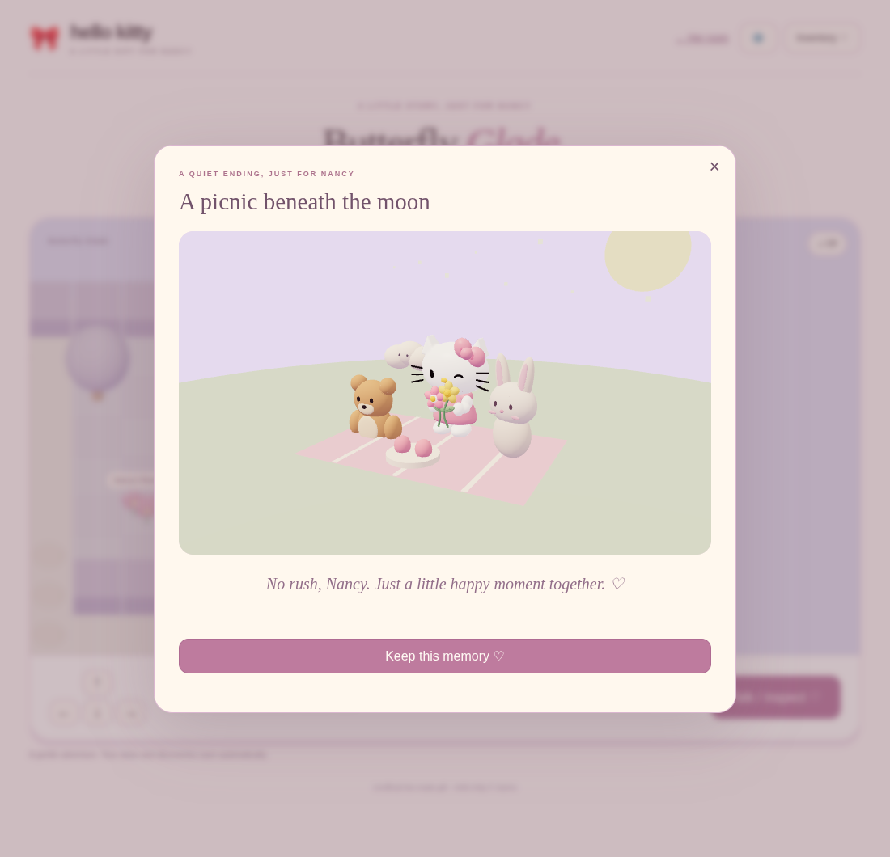

# Nancy’s Hello Kitty · A little happy place

A cozy browser game for Nancy, using our actual animated Blender Hello Kitty.
The room keeps three main buttons: **Wave hello**, **Little dance**, and
**Play a mission**. Inventory, settings, and playful interactions open in focused
panels. The same clothes, items, collection, and quests follow Kitty between her
room, Moonflower Adventure, and Butterfly Glade.

## Application stack

| Technology | What it does in this game |
| --- | --- |
| React + TypeScript | Application navigation, menus, inventory, local chat, settings, mission controls and dialogue |
| React Three Fiber | Owns the room, adventure and wardrobe-preview render loops and 3D scene composition |
| Zustand | Shared game state, durable progress, equipment, mission transitions and save migration |
| Rapier | Kinematic adventure character controller, capsule collider, map-wall and floor colliders |
| Drei | GLB loading, 360° OrbitControls, orthographic camera, loading progress and world labels |
| Three.js | Blender animation mixer, meshes, materials and geometry beneath Fiber |
| Vite | Development server, typed production build and hashed application assets |

`src/` contains the new React/TypeScript application. Existing tested game rules,
Blender animation adapters, and geometry helpers in `dist/` are reused through a
typed boundary in `src/game/domain.ts`. The active application does not run the
old DOM application or its renderer. The previous game is preserved at `classic/`
in each build, including its compatibility renderer and older optional features.

## Play

- **Her room:** wave, dance, tap the bow/head/paws/nose, or open **Play together**
  for cuddles, high fives, tickles, kisses, held-item play and a little local chat.
  Chat uses a small set of playful responses; it does not contact an AI service.
- **Look around:** drag/swipe for a full 360° orbit. Focus the room canvas and
  press Left/Right for keyboard rotation; **Reset view** returns to the front.
  Walls and the cabinet cut away for the rear view.
- **Inventory:** choose clothes and flowers, teddy, strawberry, envelope or empty
  paws. The live Blender preview rotates and changes immediately. Outfits unlock
  from quests and follow Kitty both at home and in the adventure.
- **Settings:** choose a room palette, optional music-box sound, relaxed hunts
  without a timer, and reduced motion. Device reduced-motion settings are honored.
  Audio starts only after enabling it and suspends when the tab is hidden.

| Mission | Goal |
| --- | --- |
| Bow Hunt | Collect eight floating bows; 45 seconds or relaxed mode |
| Strawberry Picnic | Collect six berries; 40 seconds or relaxed mode |
| Memory Hearts | Watch and repeat four numbered hearts; no timer |
| A Picnic for Nancy | Drag or tap four gifts into their matching spots; no timer |

A completed mission saves a keepsake and unlocks another friend until all six
are home. New friends enter, wave, and settle on the shelf. Ownership saves before
the welcome finishes; Escape skips it and reduced motion settles immediately.
Teddy play animates the actual arms into a cuddle. Feeding the strawberry takes
three bites and then refreshes it. A picnic can be replayed with a fresh board.

Nancy’s letter is reserved for the user’s own words. `dist/letter.js` deliberately
contains `pending: true` and no invented love-letter draft. Set its paragraph
array, sign-off and signature only when the author supplies the message.

## Moonflower Adventure

Open **Play a mission → Moonflower Adventure** or `adventure.html`. This is a
small browser RPG chapter: Rosemilk Village and Moonflower Garden, with no timer
or combat. Walk using arrows/WASD or the touch direction pad. Enter/Space or
**Talk / inspect** repeats a nearby interaction. Story choices stop walking.

Walk beside friends, treasure and quest objects to discover them automatically.
Cards show original illustrations, chests open, and charms rise with hearts and
stars. Reduced motion keeps the discoveries still. Enter the upper-right pink
arch by walking through it or pressing its **Enter dungeon** label. Entering
starts the quest even if you have not spoken with Momo. Rapier physically blocks
Kitty at houses, hedges and the locked moon gate.

| Quest | Steps | Reward |
| --- | --- | --- |
| Restore the moonflower | Find three chest charms, listen/tell a story/wave to the cloud guardian, pass the moon gate and approach the shrine | Moonlight dress and one room friend |
| Momo’s lost ribbons | Find three village ribbons and approach Momo | Berry sweetheart outfit |
| A picnic for Momo | Pick both southern garden berry bushes, equip Sweet strawberry, approach Momo | Room picnic basket |
| Lanterns for the garden | After restoring the flower, visit both northern lanterns and return to the shrine | Room moon lantern |

**Inventory → Quest** shows all four quests, collected charms and **Follow quest**
controls. Completing the tracked quest follows another unfinished quest. The
honey chest also unlocks the Honey picnic outfit. Rewards are granted once and
are shared with the room; reloading does not duplicate them.

## Butterfly Glade · a story to keep

Open **Play a mission → Butterfly Glade**, or use the lilac arch in the garden’s
southeast. The glade is a third map connected to the existing adventure. Direction
hints lead to each objective; walk up to objects to use the item in Kitty’s paws.
Open **Inventory → Items** to change tools, or use the nearby item button to equip
and use the right tool in one tap. On a keyboard, **E** uses that action. Only one
item is equipped at a time. Automatic encounters still work with an equipped item.

1. Equip **Butterfly lantern** and follow three butterfly markers. The first
   reveals a hidden path through the hedge. The path stays open after changing items.
2. Equip **Little watering can** beside the thirsty flowers. Their revived vines
   become an anchor for the bridge.
3. Equip **Friendship ribbon** at the broken bridge. Rapier blocks the crossing
   until it is repaired, then Kitty can walk across.
4. Arrange **moon → flower → heart** at the wishing stars by tapping or dragging.
   Wrong choices give gentle hints without removing correct stars. Leaving or
   reloading preserves the puzzle.
5. Bring **Cuddle teddy** to Pip the sleepy bunny. Find the envelope beside Pip;
   Kitty equips it to bring home. The actual letter still awaits the author’s words.
6. After restoring the original moonflower and finding the envelope, visit the
   glade picnic at the north end. Kitty, Momo, Pip and the cloud guardian gather
   in a short 3D moonlit scene. Pause or look around, then **Keep this memory**.
   Reduced motion shows a still scene. The picnic can be revisited from the storybook.

**Your storybook ♡** is available from Inventory, the mission panel and Play
together. Its twelve illustrated pages unlock from the four original quests,
the new discoveries, the picnic ending and a saved postcard. Pages can be revisited
in any order. Locked pages never expose an invented letter. Room keepsakes have
small heart buttons: tap one, or the object itself, to reopen its memory. Names
appear on hover or keyboard focus. Kitty greets Nancy, reacts to changed outfits,
and celebrates discoveries using the actual Blender rig.

**Photo corner** is also available from Inventory, Play together and the storybook.
Choose a still pose, wave, cuddle or wink; select rose, garden or lavender scenery;
and drag for a 360° view. **Save postcard PNG ♡** downloads a 1000×1200 image with a
cream frame and “For Nancy ♡”. The image preserves the character’s proportions and
current outfit, held item, pose and view. No image upload or sharing service is used.

The new chapter lives in `adventure.chapter` with its own normalized schema.
Dependencies are validated on load so a corrupt save cannot unlock the bridge,
letter or ending early. Old completed quests unlock their storybook pages without
pretending the new puzzles are complete. Classic-version saves preserve modern
chapter memories through the modern save fallback.



[Example postcard exported from the real Blender model](docs/nancy-postcard.png)

## Smoother adventures and keeping progress

Nearby tool actions appear below the map when their prerequisites are ready:
**Use butterfly lantern**, **Use watering can**, **Tie friendship ribbon**,
**Offer cuddle teddy**, and **Share strawberry picnic**. Each action checks the
current location again, equips one item and applies the encounter once. The
inventory remains available for dressing up and choosing what Kitty carries.

Kitty walks with alternating feet, arm swing and a gentle body motion on additive
pivots around the actual Blender controllers. Turns follow the shortest arc and
settle smoothly. The original Blender wave, dance and wink tracks stay usable.
Soft footsteps play only when sound is enabled. Reduced motion keeps the walking
pose still and turns immediately. Walking uses actual Rapier movement, so a blocked
wall does not keep the feet cycling in place. The kinematic controller runs on
fixed physics ticks, with movement tested at display rates from 20 through 240 FPS.
Holding a direction queues continuous steps; releasing, losing focus, opening a
story choice, or reaching an entrance clears the held input. A whole-tile collision
sweep stops Kitty before a wall, without a lunge or snap-back.

The adventure camera follows Kitty’s interpolated rendered position on every
frame, including reduced-motion mode. Physics updates run before the camera,
which updates before world labels. Logical tile commits no longer move the camera
in jumps, and held walking does not wait for an input polling timer between tiles.

Watering tilts the held can and sends a few visible drops toward the flowers;
the petals then open gradually. Bridge planks align and the friendship ribbon
ties across them. Pip stretches awake and opens her eyes. These short effects
play for new discoveries, with progress saved immediately; loading a completed
save shows the finished scene. Reduced motion shows finished states without the
moving drops or bursts. The phone camera is closer and lower, with labels mostly
limited to nearby objects and entrances.

Open **Settings → Keep your progress ♡** to download a JSON backup. On another
device, choose that file, review the current and selected progress, then press
**Restore this backup**. Collection, equipment, quests, storybook memories,
keepsakes and preferences transfer together. Chat and transient animation state
are excluded. The current save is kept as a downloadable previous save. Invalid,
oversized and unsupported files leave the current game unchanged; partial storage
writes are rolled back. Repaired glade progress also returns Kitty to a reachable
spawn when needed. This is a manual transfer; it does not introduce an account or
cloud-save service.

[Phone view with a nearby item action](docs/nancy-mobile-quick-tool.png)

## Continue your story and find your way

The mission panel offers **Continue adventure** once the story has started. It
returns to Kitty’s exact saved place and selected quest. **Moonflower Adventure**
chooses the original chapter; **Butterfly Glade** chooses the glade chapter and
resumes its last place rather than resetting to the entrance.

Tap the direction hint below the adventure scene to open **Inventory → Quest →
Your little map**. The same map is available as a folded section in the quest
panel. It shows Kitty, the next objective, and a dotted walking route derived
from the actual collision grid. Closed gates and the unrepaired bridge block
routes. Guidance follows the selected quest across all three areas, including
the moonflower prerequisite for the glade picnic and garden lanterns.

Choose an area in the map to preview it. Visited places have a **Return to…**
button; Kitty returns to her saved spot with her equipment and discoveries intact.
Unvisited places show an entrance hint. Travel does not finish quests or grant
rewards. Older saves infer known areas from existing discoveries, and start at an
entrance when no old position is available. New return points are saved per area,
included in progress backups, and preserved when returning from the classic game.
The map and quest cards remain in one panel, with tabs and a close button that
stay accessible while scrolling.

[Nancy’s walking map on a phone](docs/nancy-phone-map.png)

## Develop and verify

Use Node.js 24 and npm:

```sh
npm ci
npm run dev
```

Open the local Vite address printed in the terminal. No remote game assets,
login, Blender installation, database or API key is required to play.

```sh
npm test           # Existing game/model rules + Zustand/save migration tests
npm run build      # Prepare local assets, strict TypeScript, production bundle
npm run preview -- --port 8053
```

The new browser integration check uses a real Chromium WebGL canvas and Rapier
controller. With Python Playwright and Chromium installed and preview running:

```sh
python tests/react-browser.py
python tests/chapter-browser.py
python tests/play-polish-browser.py
python tests/navigation-browser.py
python tests/movement-browser.py
```

Set `KITTY_BASE_URL` or `CHROMIUM_PATH` to override the defaults. It checks room
controls, chat, settings, wardrobe, mission rewards, picnic replay, a physical
wall collision, all four adventure quests, reloads, shared room rewards, and phone
touch controls. The chapter check plays the new map, tests a wrong tool and a
physically blocked bridge, reloads during the star puzzle, reaches the letter and
ending, opens room souvenirs, and downloads and inspects a real postcard PNG. It
also checks the puzzle and storybook on a phone. The polish check verifies one-tap
item use, movement of the actual feet, smooth turns, rendered flower/bridge/bunny
animation, invalid-file handling, previous-save recovery, and transfer to a fresh
phone browser. Navigation checks exercise exact resume, return points, connected
quest routes, folded and expanded maps, unvisited-area hints, reloads and browser
history, including a scrolling phone panel. Older browser scripts in `tests/` target the preserved classic
application; serve `dist/` separately to run those historical checks.

Vite splits the React interface from the 3D application and wardrobe preview.
The physics WebAssembly and rendering libraries are the largest download. Assets
and dependencies are pinned in `package-lock.json` and bundled locally. Bright
pastel realtime lighting uses no grain or noisy path tracing.

## Saves and compatibility

Zustand persists durable state under `kitty-world-v2`. It migrates the existing
room, picnic collection, adventure, equipment, mission journal and preferences.
The old save keys are mirrored for the classic version. Returning from classic
or another tab rehydrates progress. Unrelated older wallet/care/sticker saves are
preserved. Animation frames, movement requests, modal visibility and chat history
are transient and do not cause repeated storage writes.

Progress belongs to this browser and origin; it is not a cloud account save.
Changing hosting domains or using a private window gives a separate save. When
storage is blocked the game remains playable and reports that saving is unavailable.

`play.html` is the previous self-contained classic room, retained as an offline
download. It is not the new React/Rapier build and does not embed the adventure.
The modern app needs HTTP hosting; upload **the contents of `build/`** after
`npm run build`. A graphics failure offers the classic compatibility version.

## Blender model

`dist/assets/hello-kitty.glb` comes from the private
[hmlim123/hellokitty3D](https://github.com/hmlim123/hellokitty3D) repository:
`hello_kitty_animated.blend`, commit `1fee5d514ba101055d1bb1c6e6957830aa3be646`.
It contains the actual head, bow, bouquet, rounded paws, controllers, wave,
dance and animated wink. It is not a primitive replacement for the character.
Provenance is recorded in `dist/assets/kitty-source.json`.

To re-export after checking out that source revision alongside this repository:

```sh
blender -b ../hellokitty3D/hello_kitty_animated.blend --threads 5 --python-exit-code 1 --python scripts/export_blender.py
```

The exporter excludes the Blender studio and converts eye visibility into glTF
morph targets. It does not modify the source `.blend`. React components load the
GLB with Drei and animate its real controllers; clothes and held props attach to
the original rig. Shelf variants keep their own palettes.

## Main files

| File | Purpose |
| --- | --- |
| `src/App.tsx` | React navigation, menus, controls and dialogue |
| `src/ui/` | Inventory, chat, settings, missions and letter |
| `src/game/store.ts` | Zustand actions, atomic rewards and persistence |
| `src/game/chapter.ts` | New map, tool puzzles, storybook pages, progress repair and ending rules |
| `src/ui/StoryPanels.tsx` | Storybook and accessible tap/drag star puzzle |
| `src/scenes/GladeScene.tsx`, `AdventureTools.ts` | Glade scenery, NPCs, and tools attached to the Blender rig |
| `src/scenes/PhotoCorner.tsx`, `MoonPicnic.tsx` | Postcard export and the replayable picnic scene |
| `src/scenes/Souvenirs.tsx` | Clickable memories in Kitty’s room |
| `src/game/world-map.ts` | Shared map geometry, collision and valid return points |
| `src/game/navigation.ts`, `travel-state.ts` | Quest routes, visited areas and saved positions |
| `src/ui/TravelMap.tsx` | Foldable walking map and returning to visited places |
| `src/game/context-action.ts` | Nearby action prerequisites and label distance |
| `src/game/backup.ts`, `src/ui/SaveBackup.tsx` | Validated backups, restore preview and rollback |
| `src/scenes/tile-motor.ts` | Fixed-step kinematic movement, swept wall checks and continuous steps |
| `src/scenes/walk-animation.ts` | Additive walking cycle and smooth turning |
| `src/scenes/DiscoveryEffects.tsx`, `effect-motion.ts` | Short discovery effects and reduced-motion easing |
| `src/game/storage.ts` | Save migration and legacy compatibility |
| `src/game/types.ts`, `domain.ts` | Shared types and boundary to existing rules |
| `src/scenes/Stage.tsx` | Fiber Canvas, physics context, loading and failure UI |
| `src/scenes/RoomScene.tsx` | Room, interactions, shelf, arrivals and 360° orbit |
| `src/scenes/AdventureScene.tsx` | Map, Rapier character controller and discoveries |
| `src/scenes/Kitty.tsx` | Actual Blender character and rig animation |
| `src/scenes/WardrobePreview.tsx` | Live 3D equipment preview |
| `scripts/prepare-assets.mjs` | Copy game assets and classic fallback for Vite |
| `dist/` | Reused domain/geometry adapters, art, model and classic application |

## Publish

GitHub Pages uses `.github/workflows/pages.yml`. Keep repository **Settings →
Pages → Source: GitHub Actions**. On changes to the app, rules, tests or build
configuration on `master`, the workflow installs locked dependencies, runs tests,
builds the typed application and deploys **`build/`**. No deploy key is needed.
A successful workflow run confirms deployment; a successful push alone does not.

Game: <https://hmlim123.github.io/hellokittygame/>

Adventure: <https://hmlim123.github.io/hellokittygame/adventure.html>

Classic compatibility version: <https://hmlim123.github.io/hellokittygame/classic/>

## Attribution

Unofficial fan-made gift, not affiliated with or endorsed by Sanrio. Hello Kitty
belongs to Sanrio. Three.js and its bundled helpers carry the MIT license; see
`dist/vendor/THREE-LICENSE.txt`. No license for Sanrio IP is granted.
