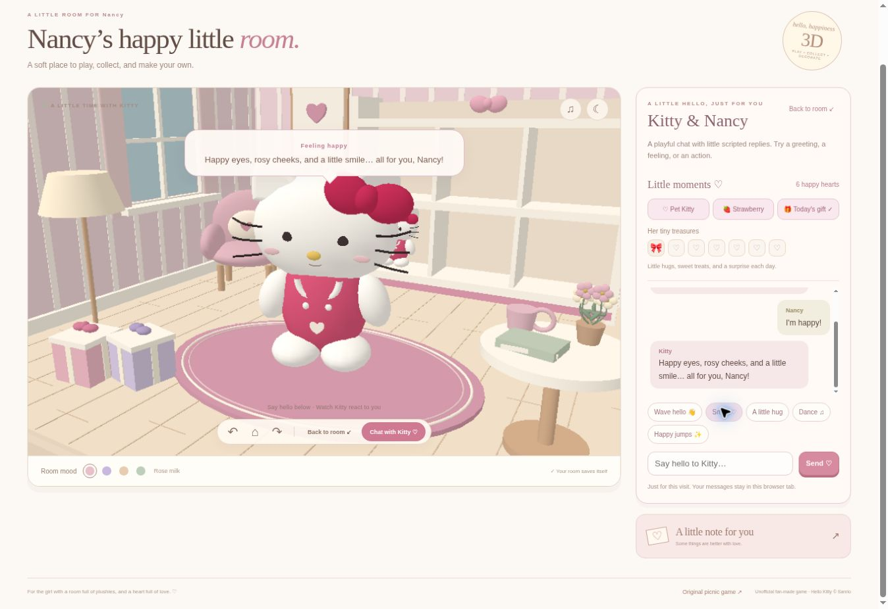
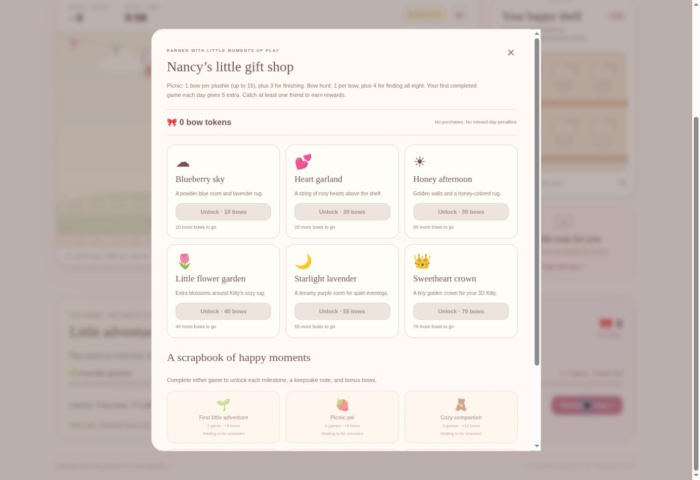

# Nancy’s Hello Kitty — Room & Plushie Picnic 🎀

A cozy, unofficial fan-made browser game created as a gift for Nancy, who loves Hello Kitty and collecting plushies.

**[Play the live game](https://kitty-plushie-picnic.hslog.chatgpt.site)**

Explore a 3D room, catch plushies in the original picnic game, chat with Kitty, and earn shared rewards. The game runs entirely in the browser; no account or backend is required.



## Games and activities

- **3D room:** rotate and zoom, change room colors, switch day/evening lighting, and arrange six collectible plushies on a shelf.
- **Bow hunt:** catch eight floating bows in 45 seconds to unlock a plushie and earn bow tokens.
- **Plushie picnic:** move Kitty’s basket to catch falling plushies and strawberries during a 60-second round. Rain clouds reduce the round score, but do not remove collected plushies.
- **Kitty chat:** playful scripted replies to greetings, feelings, and actions, with smiles, blinking, waves, hugs, dancing, and happy jumps. This is a local scripted chat, not an online language model.
- **Little moments:** pet Kitty, feed her strawberries, earn happy hearts, and collect seven daily stickers.
- **Personalization:** “Make it hers” changes the recipient’s name and love note and creates a shareable link.

Use the navigation above the game to switch between **Kitty’s room**, **Plushie picnic**, and **Gifts**.

## Shared rewards

Both games share the plushie collection and bow-token wallet on the same website and browser.

| Activity | Bow-token reward |
| --- | --- |
| Picnic | 1 per caught plushie, up to 15, plus 3 for finishing |
| Bow hunt | 1 per caught bow, plus 4 for completing all eight |
| First completed game of the day | 5 extra |
| Play milestones | Bonus tokens and a keepsake note |

Catch at least one plushie in a completed picnic to earn rewards. Ending a bow hunt early keeps the tokens for caught bows but does not advance completed-game milestones. Rewards are awarded at the end of a round. Happy points and care hearts are separate from spendable bow tokens.

Milestones unlock after **1, 3, 5, 10, 20, and 35 completed games**, awarding **5, 8, 12, 20, 30, and 50 bonus bows**, respectively. Missing a day has no penalty.

| Gift | Cost | Effect in the 3D room |
| --- | ---: | --- |
| Blueberry sky | 10 bows | Powder-blue walls and lavender rug |
| Heart garland | 20 bows | Rosy hearts above the shelf |
| Honey afternoon | 30 bows | Golden walls and a honey rug |
| Little flower garden | 40 bows | Extra flowers around Kitty |
| Starlight lavender | 55 bows | Purple room palette |
| Sweetheart crown | 70 bows | A golden crown for Kitty |

Unlock gifts in the shop, then use or put them away whenever you like. One gift per category—theme, decoration, accessory—can be equipped at a time. Tokens continue to accrue after collecting all plushies and milestones; this version has six shop gifts.



## Run locally

Prerequisites: Python 3 to serve the static game; Node.js 20 or newer and npm to run tests.

```bash
git clone https://github.com/hmlim123/hellokittygame.git
cd hellokittygame
python3 -m http.server 8000 --directory dist
```

Open **http://localhost:8000**. Keep the terminal running. The picnic is available at **http://localhost:8000/picnic.html**.

Serve the files over HTTP; opening `index.html` directly as a `file://` URL will not reliably load ES modules. No build step is needed: `dist/` contains the playable game and bundled Three.js modules.

To run the automated tests in another terminal:

```bash
npm ci
npm test
```

## Controls

| Mode | Controls |
| --- | --- |
| 3D room | Drag to orbit, scroll or pinch to zoom; use the camera buttons for quick adjustments |
| Bow hunt | Click or tap floating bows; pause with the pause button |
| Shelf | Choose a collected plushie, select “Arrange her shelf,” then choose a numbered spot |
| Picnic | Arrow keys or A/D to move, or drag on the playfield; Space or the pause button pauses |
| Chat | Type a short message or use reaction buttons |

## Saving and privacy

Progress is stored in browser `localStorage`:

- `kitty-room-3d-v1`: room settings, collection, shelf arrangement, hunt best score.
- `kitty-picnic-v1`: picnic collection and best score.
- `kitty-care-v1`: care hearts and daily stickers.
- `kitty-adventures-v1`: bow balance, shop gifts, equipped items, and milestones.

Existing picnic and room collections are merged without discarding owned plushies. There is no cloud sync: a different device, browser, or website address has separate progress. Clearing site data removes saved progress. Private browsing or blocked storage may prevent saving. The local test site and published site have separate saves.

Chat messages stay in the current tab. Personalized names and notes are encoded in the shareable URL, so anyone with that link can read them. Daily rewards use the device’s local calendar date.

## Project map

| File | Purpose |
| --- | --- |
| `dist/index.html`, `dist/room.css` | 3D room interface and styling |
| `dist/app.js` | Room controls, chat, care, hunts, and persistence |
| `dist/scene.js`, `dist/models.js` | Three.js scene, character models, and reward decorations |
| `dist/expression.js`, `dist/chat.js` | Facial transitions, avatar reactions, and scripted replies |
| `dist/care.js` | Care hearts and daily stickers |
| `dist/state.js` | Plushie collection and bow-hunt rules |
| `dist/picnic.html` | Original Canvas 2D picnic game |
| `dist/rewards.js` | Shared progression, milestones, and gift-shop rules |
| `dist/reward-panel.js`, `dist/rewards.css` | Shared navigation, shop, and keepsake UI |
| `dist/CanvasFallback.js` | Compatibility renderer when WebGL2 is unavailable |
| `dist/vendor/` | Bundled Three.js modules and license |
| `tests/` | Automated gameplay, state, reward, and expression checks |
| `docs/` | Preview screenshots |

## Customize or host elsewhere

- Edit `SHOP` and `MILESTONES` in `dist/rewards.js` to change gift costs, rewards, and keepsake notes.
- Edit `dist/chat.js` to add local chat replies and reactions.
- Edit `dist/care.js` to change daily sticker notes.
- Use “Make it hers” for a personalized link without changing code.
- Deploy the contents of `dist/` to a static web host. Keep its folder structure intact; all game assets use relative paths. This repository upload does not itself enable GitHub Pages.

The existing playable site is hosted separately through ChatGPT Sites. Changes committed to GitHub do not automatically update that site.

## Validation and limitations

The current release passed 26 automated checks covering collisions, scoring, replay, saves, collection merging, reward accounting, duplicate-award prevention, gift ownership, facial geometry, and reduced-motion behavior. Browser checks covered room interactions, navigation, shop unlocking, and the picnic interface. Full WebGL lighting was not verified in the preview browser; its compatibility renderer was used there.

## Attribution

Unofficial fan-made gift project; not affiliated with or endorsed by Sanrio. Hello Kitty belongs to Sanrio. No ownership of Sanrio characters or trademarks is claimed.

Three.js is distributed under the MIT license; see [`dist/vendor/THREE-LICENSE.txt`](dist/vendor/THREE-LICENSE.txt). Its bundled license notices are preserved. No license for Sanrio intellectual property is granted by this repository.
