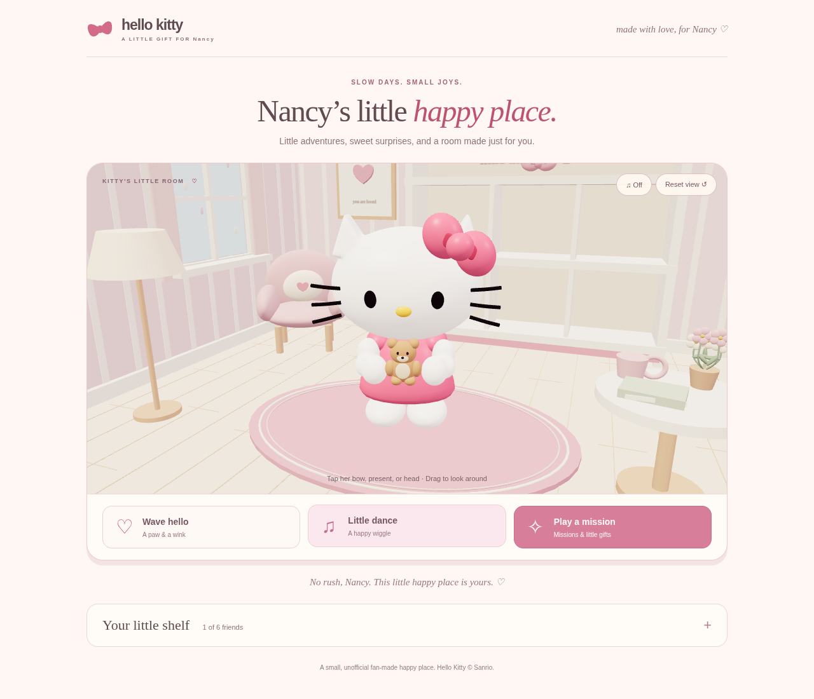

# Nancy’s Hello Kitty · A little happy place

A small browser game made as a gift for Nancy, built around **our actual Blender
Hello Kitty model**. The home page keeps three actions: **Wave hello**, **Little
dance**, and **Play a mission**. The mission button opens one tidy panel with
**Missions**, **Gifts**, and **For Nancy** tabs. The tabs support arrow-key navigation.

## Nancy’s little adventures

| Mission | How to play | Finish |
| --- | --- | --- |
| Bow Hunt | Find the floating bows | 8 bows; 45 seconds or relaxed mode |
| Strawberry Picnic | Gather the 3D strawberries | 6 berries; 40 seconds or relaxed mode |
| Memory Hearts | Watch four numbered hearts light up, then repeat their order | Correct 4-heart sequence; no timer |
| A Picnic for Nancy | Drag or tap the four gifts into their cozy spots | All four placed; no timer |

Memory Hearts accepts input only after the cue sequence. A wrong answer replays
the same sequence, with no penalty. **Watch again** resets the current attempt;
pause freezes both cues and input. Relaxed mode removes the timer from the two
collecting missions. A completed mission brings another friend home until all
six are collected; replaying remains available afterwards.

Every mission’s first completion opens one keepsake note for Nancy in **For
Nancy**. The panel also links to her sealed letter. There are no streaks,
deadlines, currencies, or chores attached to the keepsakes.

## Little gifts and moments

In **Play a mission → Gifts**, choose **flowers**, a **cuddle teddy**, a **sweet
strawberry**, or a **heart-sealed love letter**. Tap the present in Kitty’s paws
to play with it. The choice saves and follows the selected friend:

- Teddy: a gentle squeeze with the actual Blender arms moving into a cuddle.
- Strawberry: three tap-to-feed bites, then a fresh serving. Repeated taps wait
  for the current bite to finish; switching items clears transient play.
- Letter: opens a sealed envelope. Break the heart seal to read it and fold it
  again whenever you like. It also opens from the **For Nancy** tab.
- Flowers: starts the picnic activity, with all four gifts to arrange.

The picnic supports a real pointer drag or selecting an item and then a spot
by tap/keyboard. Wrong spots give a hint, with no penalty. Only placing all four
awards a friend and keepsake. Leaving early preserves earned collections but
resets the current picnic. Reduced motion skips the friend entrance as before.

The letter's text is reserved for the user's own message. `dist/letter.js` has
`pending: true` and no invented draft. Until the message is supplied, the paper
shows a clear “being written” placeholder. Set `pending: false`, the paragraph
array, sign-off and signature when the author provides the actual words. Letter
content is rendered as text. Opening the seal is remembered in preferences.
The original flowers are part of the Blender model; the additional lightweight
3D gift props attach to the same exported bouquet controller. The character
itself remains the actual Blender mesh and rig.

Kitty breathes and blinks gently, follows nearby pointer movement, and blends
between poses. Tap her bow for a head tilt or her head for a pet. New friends
enter, wave, and settle onto the shelf. Ownership saves **before** the welcome;
Escape skips it, and reduced motion settles the friend immediately.

Optional music-box sound starts only when enabled, with chimes for catches and
arrivals. Audio suspends when the tab is hidden. A few slow petals float by the
window. The shelf and room colors remain in one expandable panel below the room.



## Run locally

Python 3 is enough to serve the game. No build step is required, and all assets,
including Three.js and the 1.7 MB character model, are bundled locally.

```sh
python3 -m http.server 8000 --directory dist
```

Open `http://localhost:8000`. Serve over HTTP: opening `index.html` as a file
will not reliably load modules or the GLB asset. Drag to orbit and scroll/pinch
to zoom. The main buttons and bow targets also work with the keyboard.
Escape pauses a hunt; the Pause button and Space on the scene canvas do too.

The WebGL renderer is preferred. A software compatibility renderer uses the
same imported model and camera when WebGL2 is unavailable, at lower performance.
Reduced motion replaces moving reactions with a brief, static wink.

## Play without Terminal

Download `play.html` from this repository and open it in a desktop browser.
It contains the complete game, Three.js, and the Blender model in one file;
no server, account, or Internet requests are needed for gameplay. File-based
browser storage varies, so saves are best-effort and separate from the hosted
site's saves. The self-contained HTML was verified in an isolated browser
document, including the eight-bow hunt, with zero HTTP requests. Direct
`file://` navigation could not be tested because this cloud browser blocks it.

Regenerate the standalone file after changing the game:

```sh
npm exec --yes --package=esbuild@0.28.2 -- esbuild dist/app.js --bundle --format=esm --target=es2022 --minify --outfile=/tmp/kitty-standalone.js
python scripts/build_standalone.py /tmp/kitty-standalone.js play.html
```

`play.html` is a downloadable artifact, not a published website or ChatGPT
playable card. For hosting, upload the contents of `dist/` to a static host.

## The Blender model

`dist/assets/hello-kitty.glb` is exported from
[hmlim123/hellokitty3D](https://github.com/hmlim123/hellokitty3D), specifically
`hello_kitty_animated.blend` at commit `1fee5d514ba101055d1bb1c6e6957830aa3be646`.
It includes the actual head, bow, bouquet, rounded paws, controller hierarchy,
and animation. It is not a recreation using browser primitives. The Blender
studio is excluded, the meshes are reduced for browser use, and the wink’s
render-visibility keys are converted into glTF morph targets.

The source and conversion details are recorded in `dist/assets/kitty-source.json`.
The Blender source remains in its private repository; it is not needed to play.

To reproduce the GLB after checking out that source commit alongside this repo:

```sh
blender -b ../hellokitty3D/hello_kitty_animated.blend --threads 5 --python-exit-code 1 --python scripts/export_blender.py
```

This updates the game asset and provenance JSON without saving or changing the
input Blender file. If exporting a different model revision, update the source
commit in the exporter’s provenance metadata too. The runtime combines Blender’s
object animation tracks and plays the wave/wink and dance portions with an
`AnimationMixer`. Lighting is smooth and pastel, without grain textures or cast
shadow noise. The browser lighting differs from the original Blender studio.

## Saved progress and older features

The main page continues to read `kitty-room-3d-v1` and merges owned friends from
`kitty-picnic-v1`. Existing owned friends, shelf placements, selected friend,
room color, best score, and completed hunts are retained. Old evening settings
remain saved, while the simplified room opens in daylight.

Care hearts, stickers, wallet balances, milestones, purchased gifts, and equipped
shop items are **not deleted or overwritten**. Their interfaces and effects are
not active on the simplified main page. New hunts unlock friends, rather than
awarding wallet tokens. A partial or expired hunt keeps your friends safe but
does not unlock a new one.

The older picnic remains at `picnic.html` for existing direct links. Its modules
and tests remain in the repository, but it is no longer linked from the home
page. Chat, care, and reward modules are retained for compatibility. Their interfaces
are not part of the simplified page; the scene still shares some legacy helpers.

Nancy’s mission counts and keepsake unlocks use `kitty-nancy-missions-v1`.
The held gift and relaxed setting use `kitty-room-preferences-v1`. These keys
are separate from the pre-existing collection, care, and wallet saves. Mission
completion updates the journal and friend collection once; wrong memory answers,
replays of the cues, and unfinished missions award neither a friend nor a keepsake.

Progress is local to the same browser and site address. Moving to another host,
using another device, or clearing site data means a different save. Blocked
storage shows a saving warning. There are no accounts, remote chat requests,
or external asset requests. An old `?to=` link still displays its recipient as
plain text, without adding another settings screen.

## Checks

Node.js 20+ and npm are needed for the tests:

```sh
npm ci
npm test
```

48 automated checks cover the Blender asset, real paw and wink playback, pose
reset, continuous gesture switching, bounded attention, blinking, touch targets,
friend arrivals, opt-in audio, relaxed hunts, gift replacement, timed/memory
mission rules, keepsake persistence, picnic placement, item play, the reserved
letter, reduced motion, independent model instances,
collection migration, bow
hunt rules, saved progress, and the retained legacy modules.

Browser checks exercised actual WebGL loading, wave/dance, a complete eight-bow
hunt, pause/resume, partial completion, unlock persistence across reloads, old
collection migration, saved theme and selection, untouched care/wallet saves,
phone layout, touch raycasts, optional sound, relaxed-mode persistence, and
ownership saved before the visible arrival finishes. The compatibility renderer
was also checked with WebGL disabled. The mission browser checks exercise all
four gift choices, gift persistence, a full Strawberry Picnic, memory cues,
wrong-answer replay and completion, Nancy’s notes, keyboard tabs and mobile gifts. Item-play checks cover the actual 3D feeding taps, the teddy
cuddle, letter seal/fold controls, pointer dragging, keyboard placement, reward
persistence, cancellation, and touch placement on a phone.
Preview screenshots are in `docs/simple-room-*.png`.

The browser smoke test is also saved in `tests/browser-smoke.py`. With the local
server on port 8012, Python Playwright and its Chromium installed, run:

```sh
python tests/browser-smoke.py
python tests/missions-browser.py
python tests/items-browser.py
```

Set `KITTY_BASE_URL` for another local port or `CHROMIUM_PATH` to use an installed
Chromium executable. This test writes the documented screenshots into `docs/`.

## Main files

| File | Purpose |
| --- | --- |
| `dist/index.html`, `dist/simple.css` | Simplified responsive page |
| `dist/app.js` | Three actions, bow hunt, collection, and saves |
| `dist/blender-kitty.js` | Imported model, pose blending, idle motion and touches |
| `dist/friend-arrival.js` | Arrival timing and shelf placement |
| `dist/sound.js` | Opt-in synthesized music and chimes |
| `dist/missions.js` | Mission state, memory cues, and Nancy’s keepsakes |
| `dist/gifts.js` | Held props, cuddle and feeding play on the Blender rig |
| `dist/item-play.js` | Picnic placement rules and pointer/tap controls |
| `dist/letter.js` | User-authored letter content (pending) |
| `dist/assets/hello-kitty.glb` | Actual exported Blender character |
| `dist/scene.js` | Three.js room, camera, and interactions |
| `scripts/export_blender.py` | Reproducible Blender-to-game export |
| `tests/` | Automated model, game, and compatibility checks |

## Hosting

GitHub Pages deployment is configured in `.github/workflows/pages.yml`.
In repository **Settings → Pages**, keep **Source: GitHub Actions** selected.
The workflow uploads only `dist/`, including the actual Blender GLB, and deploys
it to the `github-pages` environment. It runs on pushes changing the game or
workflow on `master`, and can also be started manually from the Actions tab.
No deploy key or extra secret is required; GitHub's built-in workflow token
uses Pages and OIDC permissions.

Expected public game address: `https://hmlim123.github.io/hellokittygame/`.
Check the **Publish Hello Kitty game** run in GitHub Actions and use the URL
reported by the deployment. A successful push alone does not confirm deployment.
The environment may require an approval if repository protection rules say so.
Keep the repository private; Pages availability depends on the account plan.

The old ChatGPT Sites deployment is separate and is not updated by this workflow.
Moving to the new GitHub Pages address starts a separate browser save; older
progress remains stored at the old website. The self-contained download also
has separate saves.

## Attribution

Unofficial fan-made project, not affiliated with or endorsed by Sanrio.
Hello Kitty belongs to Sanrio. No ownership of Sanrio characters or trademarks
is claimed. Three.js and the bundled GLTFLoader/BufferGeometryUtils carry the
MIT license; see `dist/vendor/THREE-LICENSE.txt`. No license for Sanrio IP is granted.
